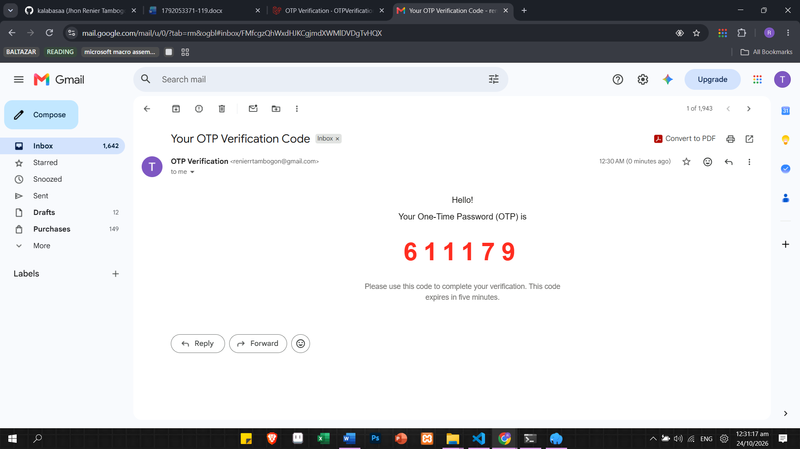
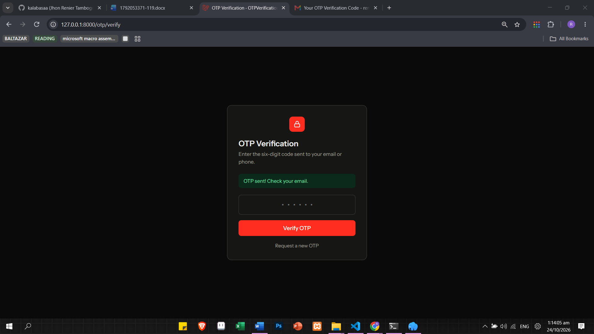
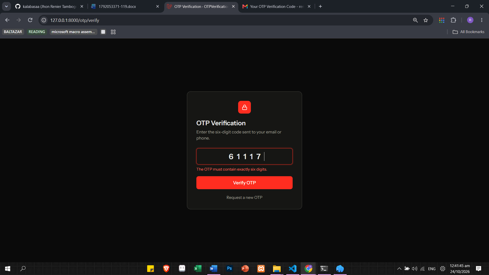
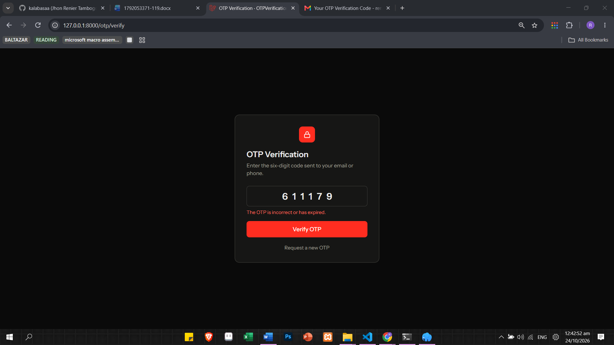
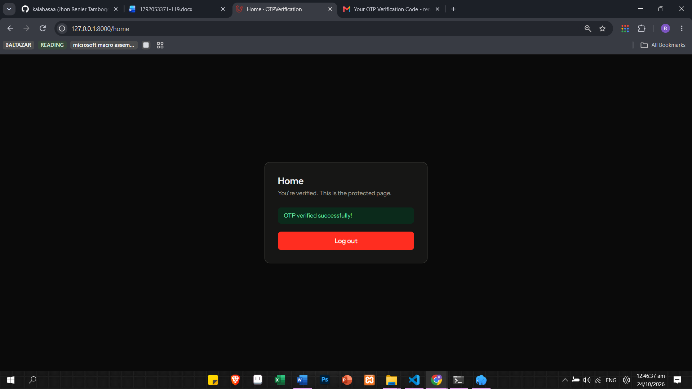

# 
Laravel OTP Verification System

  A simple Laravel web application that verifies users through email-based One-Time Password (OTP) authentication.

  
  
  
  
  

  
  

---

  <strong>College of Information Technology</strong> 
  Final Laboratory Activity 1 
  Integration of One-Time Password (OTP) via Email or SMS 
  Web Development / Laravel Programming 
  First Semester, A.Y. 2026–2027

  <strong>Student:</strong> Jhon Renier Tambogon 
  <strong>Year and Section:</strong> BSIT 3-F

---

## About

This project implements email-based OTP verification in Laravel. It generates a six-digit code, sends it through email, and verifies the code before allowing access to a protected page.

**Note:** This project focuses on email OTP. SMS integration using Twilio is an advanced task and is not included.

## College of Information Technology

**Final Laboratory Activity 1: Integration of One-Time Password (OTP) via Email or SMS**

- **Course:** Systems Integration and Architecture 1
- **Academic Year:** First Semester, A.Y. 2026–2027
- **Student Name:** Tambogon, Jhon Renier 
- **Year and Section:** BSIT 3-F
- **Date:** October 23, 2025

## Objectives

1. Generate a six-digit OTP using PHP and Laravel.
2. Configure Laravel to send OTPs through email.
3. Understand SMS integration using services such as Twilio.
4. Validate OTPs and implement expiration and session handling.
5. Display customized error and success messages.

## Features

- Six-digit OTP generation
- Email delivery using SMTP
- Hashed OTP storage in the session
- Five-minute OTP expiration
- OTP verification and session handling
- Validation for empty, invalid, and expired codes
- Limited verification attempts and request throttling
- Protected home page after successful verification
- Customized error and success messages

**Note:** This implementation focuses on email-based OTP verification. SMS integration using Twilio is an advanced task and is not included in the current implementation.

## Screenshots

### 1. Request OTP Page

The page where the user requests an OTP through email.

### 2. OTP Email

The email containing the generated OTP received in the user's inbox.

### 3. Verify OTP Page

The page where the user enters the six-digit verification code.

### 4. Empty OTP Field Error

Displayed when the user submits the form without entering a code.

**Message:** `Please enter the OTP.`

### 5. Invalid OTP Length Error

Displayed when the entered code does not contain exactly six digits.

**Message:** `The OTP must contain exactly six digits.`

### 6. Incorrect or Expired OTP Error

Displayed when the entered OTP is incorrect or has expired.

**Message:** `The OTP is incorrect or has expired.`

### 7. Successful Verification

The protected home page displayed after successful OTP verification.

**Message:** `OTP verified successfully!`

## How OTP Verification Works

1. The user requests an OTP using their registered email address.
2. Laravel generates a random six-digit code and stores its hashed version in the session with an expiration time.
3. Laravel sends the OTP through email using the configured SMTP settings.
4. The user enters the code on the verification page.
5. Laravel checks the code, expiration time, and verification attempt limit.
6. If the OTP is correct, the code and related session data are removed, the session ID is regenerated, and the user is redirected to the protected home page.
7. If the OTP is incorrect or expired, the application displays an error message and denies access.

## Test Results

| Test Case | Expected Result | Status |
|---|---|---|
| Request OTP | OTP is sent to the registered email | Passed |
| Empty OTP | Displays an empty-field error | Passed |
| OTP with fewer or more than six digits | Displays a validation error | Passed |
| Incorrect OTP | Displays an error and denies access | Passed |
| Expired OTP | Rejects the expired code | Passed |
| Correct OTP | Redirects to the protected home page | Passed |
| Reuse of verified OTP | Prevents the code from being reused | Passed |

*Testing results should reflect the actual results of your application. Change any status if that test has not been performed successfully.*

## Guide Questions

**1. What is a One-Time Password, and how does it improve application security?**

An OTP is a six-digit code that can only be used once and expires after a few minutes. It adds extra security to the account.

**2. How does Laravel generate and deliver an OTP through email?**

Laravel generates a random six-digit code, hashes it, stores it in the session, and sends it through email using SMTP.

**3. What configuration is required to send OTPs through SMS using Twilio?**

Install the Twilio SDK using Composer, then add the account SID, authentication token, and Twilio phone number to the `.env` file to send OTPs through SMS.

**4. Why should an OTP have an expiration time?**

An OTP needs an expiration time so old codes cannot be used later. In this project, it expires after five minutes.

**5. What should happen after an OTP has been successfully verified?**

The OTP is deleted to prevent reuse. The user is then redirected to the home page.

**6. How do customized error messages improve the user experience?**

Customized error messages help users understand what went wrong and how to fix it.

**7. What security risks may occur if an OTP can be reused or guessed repeatedly?**

Attackers could reuse or repeatedly guess the OTP to access an account. Attempt limits, expiration, and request throttling help prevent this.

## Conclusion

In this activity, I learned how to implement OTP verification in Laravel, from generating and sending the code to verifying it securely. I also experienced and fixed email authentication and database errors. This helped me understand how OTP expiration, attempt limits, and one-time use improve application security.

## Submission Checklist

- [x] Laravel project source code
- [x] OTP generation and verification
- [x] Email OTP delivery
- [x] Customized validation and error messages
- [x] Screenshots of verification and error screens
- [x] Explanation of OTP verification
- [x] Test-results table
- [ ] SMS implementation, if assigned

